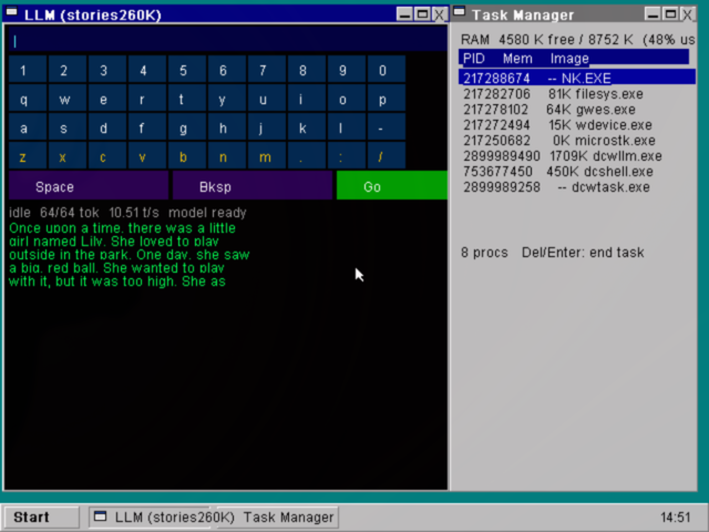

<h1 align="center">llm-dc — a tiny language model on Windows CE for Dreamcast</h1>

<p align="center">
  <br>
  <em>dcwllm.exe — a 260K-parameter Llama-2 — writing a story on the Dreamcast's SH-4,<br>
  as an ordinary Windows CE process next to Task Manager.</em>
</p>

<p align="center">
  
  
  
  
</p>

---

A complete, local inference path for the Dreamcast: the checkpoint and tokenizer live on the
disc, `dcwllm.exe` loads them with plain Win32 CE file APIs, and a decoder-only Transformer
generates text on the SH-4. No server, no companion process, no GPU compute — the model runs
in the same kind of CE process as Calculator.

This repo is the [`wince-dc`](https://github.com/ryanseddon/wince-dc) tree at the commit that
added the LLM, kept as its own project so the model work can move independently of the OS.

<p align="center">
  <br>
  <em>Push Go and it writes — one transformer step per frame, ~10 tokens/sec.<br>
  <a href="screens/dcwllm/dcwllm.mp4">Full-quality MP4</a> (same clip, H.264).</em>
</p>

## The model

`stories260K` — Karpathy's TinyStories checkpoint from [`llama2.c`](https://github.com/karpathy/llama2.c),
in its 260K-parameter configuration.

| | |
|---|---|
| Architecture | Llama-2 (RMSNorm, RoPE, SwiGLU, GQA) |
| Layers | 5 |
| Width / FFN | `dim=64`, `hidden_dim=172` |
| Heads | 8 query, 4 KV (grouped-query) |
| Vocab / context | 512 tokens / 512 positions |
| Weights | 1,056,540 bytes, fp32, single flat blob |
| Sampling | greedy (`temperature=0`), `top_p=0.9`, fixed seed |
| Tokens per run | 64 |

Generation is **one transformer step per UI frame**: the window repaints between tokens instead
of blocking on a `generate()` loop. Push Go and the desktop stays live — drag the window, open
Task Manager, watch `dcwllm.exe` tick along at ~10 tokens/sec.

## Running it

### 1. Model files

The checkpoint and tokenizer are **not in this repo** (`extradata/*` is gitignored — the blob is
third-party model data). Download them from the `llama2.c` / `esp32-llm` data folders:

| File | What | Size |
|---|---|---|
| `stories260K.bin` | fp32 checkpoint (header + weights) | 1,056,540 B |
| `tok512.bin` | 512-entry BPE vocabulary + scores | 6,227 B |

Drop both into [`extradata/`](extradata/). Everything in that folder is copied to the disc's
`\CD-ROM` by the `gdi` target, which is where `dcwllm.exe` looks for them.

### 2. Build

The whole toolchain is vendored — the SH-4 `cl.exe` and the CE image tools run under Wine on
Linux (or natively on Windows). Requires CMake ≥ 3.20, Ninja, `wine` and `pwsh`.

```sh
cmake -G Ninja -S . -B build -DAUTORUN="dcshell.exe -auto-llm"
cmake --build build --target gdi       # modules -> NK.bin -> 0winceos.bin -> disc.gdi
```

`-DAUTORUN="dcshell.exe -auto-llm"` boots straight to the desktop and opens the LLM side by side
with Task Manager. Without it the image boots the stock `dcwboot.exe` menu and you launch the LLM
from its desktop icon.

Want just the executable? `cmake --build build --target dcwllm` produces
`build/modules/dcwllm.exe`.

### 3. Boot it

`build/disc/disc.gdi` is a standard multi-track Dreamcast disc:

- **Flycast / RetroArch** — load `disc.gdi` directly.
- **GDEMU / MODE / USB-GD-ROM** — copy `disc.gdi` plus its tracks to the SD card.
- **Hardware** — burn it, or use `toolchain/make-gdi-real.ps1` for a GD-R exact layout.

Type with the on-screen keyboard (D-pad + A/Enter, or the analog pointer), or just hammer keys on
the emulator's keyboard. Press **Go** with an empty prompt and the model rambles from scratch.

## How it works

```
prompt ──BPE──> tokens ──forward()──> logits ──sample──> token ──decode──> output buffer
                            ▲                                                   │
                            └────────── one token per DCWin frame ──────────────┘
```

Nothing in the stock CE kernel or network stack knows about language models. The app is layered
the same way every other DCWin app is:

| Layer | Where |
|---|---|
| Desktop | `shell/dcshell.c` — LLM icon, `-auto-llm` launch, side-by-side placement |
| Client | `shell/dcwlib.c` — `DCWinOpen`, frame submission, key/pointer ring, crash wrapper |
| App | `shell/dcwllm.c` — prompt field, OSK, Go/Clear, frame-driven decoding, t/s status |
| Inference | `llm/llm.c`, `llm/llm.h` — checkpoint load, BPE, forward pass, sampling |
| Runtime | CE heap, `CreateFileW`/`ReadFile`, `FloatMath.lib` |

### What CE 2.12 forced

- **Wide file APIs.** `CreateFileW` + `ReadFile` instead of `fopen` — CE's ANSI file layer is
  unreliable for `\CD-ROM` paths.
- **No `calloc`, no `bsearch`.** Both are shimmed locally.
- **Soft float.** `expf`/`sinf`/`cosf`/`sqrtf`/`powf` map onto `FloatMath.lib`'s `exps`/`sins`/…
- **No `mmap`.** The 1 MB blob is read straight into heap.
- **No `__attribute__((aligned))`.** llama2.c's `v4sf` vector type collapses to plain `float`;
  the ABI of the blob is unchanged.

## Performance

Measured on the status line (`<state> <pos>/<steps> tok <n> t/s`):

| Path | Speed | Notes |
|---|---|---|
| Scalar C matmul (this commit) | ~10.5 tok/s | 4-way unrolled inner loop, soft-float target |
| SH-4 `FTRV` assembly kernel | ~14.8 tok/s | experimental, not in this snapshot — see roadmap |

Flycast's JIT is not cycle-accurate, so treat these as relative figures rather than a hardware
benchmark. Memory is the harder constraint than throughput: ~1.03 MB of weights plus ~640 KB of
KV cache (`2 × layers × seq_len × kv_dim × 4 B`) inside a 16 MB console, alongside CE, the
compositor and the rest of the desktop.

## Source map

| Path | What |
|---|---|
| `llm/llm.c` | checkpoint/tokenizer loading, BPE, `forward()`, sampler |
| `llm/llm.h` | config, weights, run state, tokenizer, sampler types |
| `shell/dcwllm.c` | the CE application: UI + frame-paced generation |
| `shell/dcwlib.c` | DCWin client library used by every `dcw*` app |
| `CMakeLists.txt` | `dcwllm` target (links `coredll`, `corelibc`, `FloatMath`) |
| `vendor/wcesdk/image/platform.bib` | places `dcwllm.exe` in the CE ROM image |
| `extradata/` | disc drop folder — put the model files here |

## Roadmap

- **Phase 1 (done)** — scalar, correct inference, interactive UI, frame-paced decoding.
- **Phase 2** — hand-written SH-4 `FTRV`/`FIPR` matmul kernels (`shasm.exe` dialect, not GCC
  asm). Prototypes ran but produced wrong logits; the target is ~3–5× over scalar.
- Bigger checkpoints (TinyStories 1M/3M) once the KV cache fits comfortably.
- Prompt presets on the OSK, so a demo does not need typing.

## Provenance

- `llm/llm.c`, `llm/llm.h` — port of [`esp32-llm`](https://github.com/DaveBben/esp32-llm)'s
  `llm.c`, itself derived from Karpathy's [`llama2.c`](https://github.com/karpathy/llama2.c). The
  FreeRTOS dual-core path, the Xtensa dot-product intrinsics and the mmap shim are stripped.
- Everything else (DCWin shell, compositor, image pipeline) is from `wince-dc`; the vendored
  Sega "Dragon" CE 2.12 SDK binaries are research material — don't redistribute them.
- This repo is the whole `wince-dc` tree, not a pruned fork: `shell/`, `net/`, `drivers/` and the
  vendored toolchain are still here because the LLM app needs the shell, the DCWin client library
  and the image pipeline to run. The OS itself lives at
  [`ryanseddon/wince-dc`](https://github.com/ryanseddon/wince-dc).
