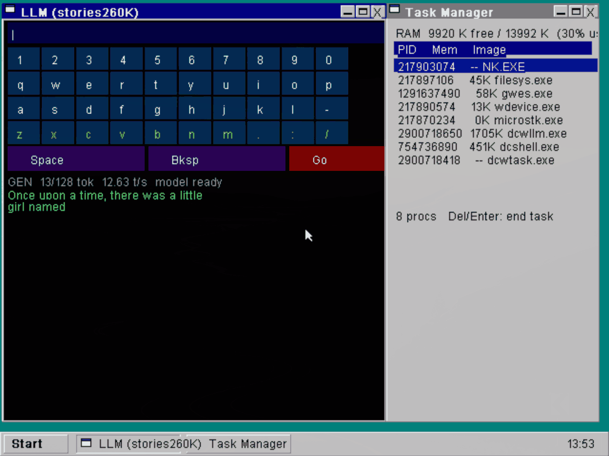

# llm-dc

A 260K-parameter Llama-2 ([TinyStories](https://github.com/karpathy/llama2.c)) running locally on the Sega Dreamcast's 200 MHz SH-4 as a standard Windows CE 2.12 GUI app (`dcwllm.exe`).

Built on [`wince-dc`](https://github.com/ryanseddon/wince-dc), ported from [`esp32-llm`](https://github.com/DaveBben/esp32-llm) / [`llama2.c`](https://github.com/karpathy/llama2.c).

<p align="center">
  <br>
  <em>One transformer step per UI frame (~10.5 tok/s) alongside Task Manager. <a href="screens/dcwllm/dcwllm.mp4">MP4</a></em>
</p>

## Details

- **Model:** `stories260K` — 5 layers, `dim=64`, `hidden_dim=172`, 8Q/4KV heads, 512 vocab/ctx, 1.05 MB fp32 weights + ~640 KB KV cache inside 16 MB RAM.
- **Execution:** Frame-paced decoding (one token per DCWin frame) so the desktop remains interactive while generating.
- **CE 2.12 constraints:** Wide Win32 file I/O (`CreateFileW`/`ReadFile` off `\CD-ROM`), heap-loaded weights (no `mmap`), soft-float maths via `FloatMath.lib`, local `calloc`/`bsearch` shims.
- **Code:** [`llm/llm.c`](llm/llm.c), [`llm/llm.h`](llm/llm.h) (inference + BPE), [`shell/dcwllm.c`](shell/dcwllm.c) (DCWin UI).

## Build & Run

1. Drop `stories260K.bin` (1,056,540 B) and `tok512.bin` (6,227 B) from [`llama2.c`](https://github.com/karpathy/llama2.c) / [`esp32-llm`](https://github.com/DaveBben/esp32-llm) into `extradata/`.
2. Build the Dreamcast `.gdi` image (requires CMake ≥ 3.20, Ninja, `wine`, `pwsh`):
   ```sh
   cmake -G Ninja -S . -B build -DAUTORUN="dcshell.exe -auto-llm"
   cmake --build build --target gdi
   ```
3. Boot `build/disc/disc.gdi` in Flycast or on hardware (GDEMU/MODE/GD-R).
